# Health Pricing Workbench

A web app that helps a health insurance pricing analyst quote customers, inspect rating factors, monitor
actual-versus-expected (A/E) experience and drift, and test rate changes through a reviewed approval workflow.
It is the capstone for the DataTalksClub AI Dev Tools Zoomcamp.

> Status: work in progress. All premiums are illustrative.

## The problem

A pricing analyst who owns a fitted health insurance tariff has to answer the same questions again and again.
What would this customer pay, and why? Which rating factors drive the price? Is the book still behaving as the
model expects? What would happen to premiums if we changed the rate? Today the answers sit in notebooks and
spreadsheets, and a rate change has no review trail.

## What it does

1. Shows the active model version, its validation results and its assumptions.
2. Quotes a customer from age, region and seven condition flags, with a factor-by-factor breakdown.
3. Lets the analyst explore the relativity of every rating factor level, with exposure and confidence intervals.
4. Monitors A/E and drift (PSI) and flags segments where the recalibration rule triggers.
5. Tests a rate change (base rate, relativities, caps and floors) and shows the impact on the in-force book,
   including the distribution of individual changes and the projected A/E.
6. Sends a scenario through review. The Analyst submits it. A Reviewer approves or rejects it with a comment.
   Every status change goes to an audit trail.

Rules the app enforces:

- Premiums are illustrative, and every premium screen says so.
- Quote inputs are permitted rating factors only. Sex, race, income and education are not inputs.
- Only aggregated data is served. No person-level records leave the pricing service.
- A scenario is editable while Draft only. Submitted, Approved and Rejected scenarios are immutable.
- A reviewer cannot approve or reject a scenario they created, edited or submitted.

## Related projects

- Modelling project (Phase 1): [asudarmo/health-pricing-meps](https://github.com/asudarmo/health-pricing-meps).
  It fits the model on MEPS data and publishes the pricing service. This app calls that service over HTTP and
  contains no modelling code, so every number comes from the service.
- UI prototype: [asudarmo/health-pricing-lovable-ui](https://github.com/asudarmo/health-pricing-lovable-ui),
  generated with Lovable and imported into `frontend/`.

See `_docs/plan.md` for the scope.

## How it is built

| Part | Choice |
|---|---|
| Frontend | React with TanStack Start, built as a static single-page app |
| Backend | FastAPI, SQLAlchemy and Alembic, with SQLite |
| Auth | Two demo logins that issue signed JWTs (see Limitations) |
| Contract | `api/openapi.json`, generated from the backend and checked against the frontend client |
| Serving | Caddy serves the app and proxies `/api` |
| Pricing | The published image `ghcr.io/asudarmo/health-pricing-meps:v1.1`, or a mock built from its OpenAPI schema |

Two version numbers appear in this project. Pricing service v1.1 is the software release (the image above, which added `/model`, the histogram and projected A/E). Model v1 is the pricing model it serves, the 2022-fitted tariff shown as "Active model" on the Home page. Pricing service v1.1 serves model v1.

## How the agents worked

An engineer agent (Claude Code) built each task from a GitHub issue with written acceptance criteria and posted a
self-check against each criterion as an issue comment. A separate QA subagent verified only the scenario impact
and the approval workflow, and returned PASS or FAIL without fixing code. `AGENTS.md` points to the modular
documents in `_docs/`: the plan, the process, the decisions log and the session log. The human owner made every
decision that changed scope, roles, the workflow or the hosting choice.

## Walkthrough

Live demo: https://35-254-148-15.sslip.io. For a page-by-page checklist of what to try, see the [reviewer guide](docs/reviewer-guide.md).

1. Open the app and sign in as the Analyst.
2. Quote a customer, look at the rating factors and the monitoring page.
3. Open Scenarios, create a scenario, check the impact, save it and submit it.
4. Sign out and sign in as the Reviewer. Open the submitted scenario and approve or reject it with a comment.
5. Open the scenario again to see the audit trail. The Analyst can no longer edit it.

## Screenshots

| | |
|---|---|
| 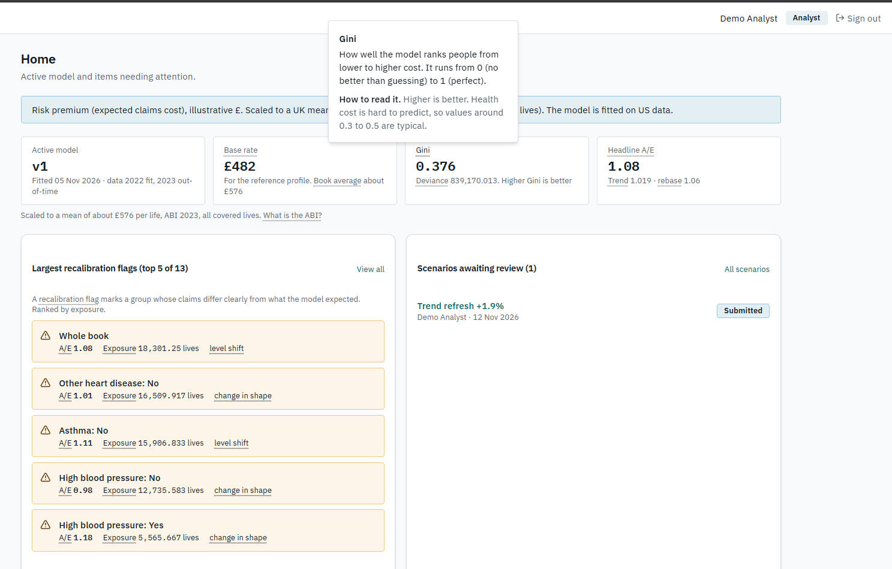 | 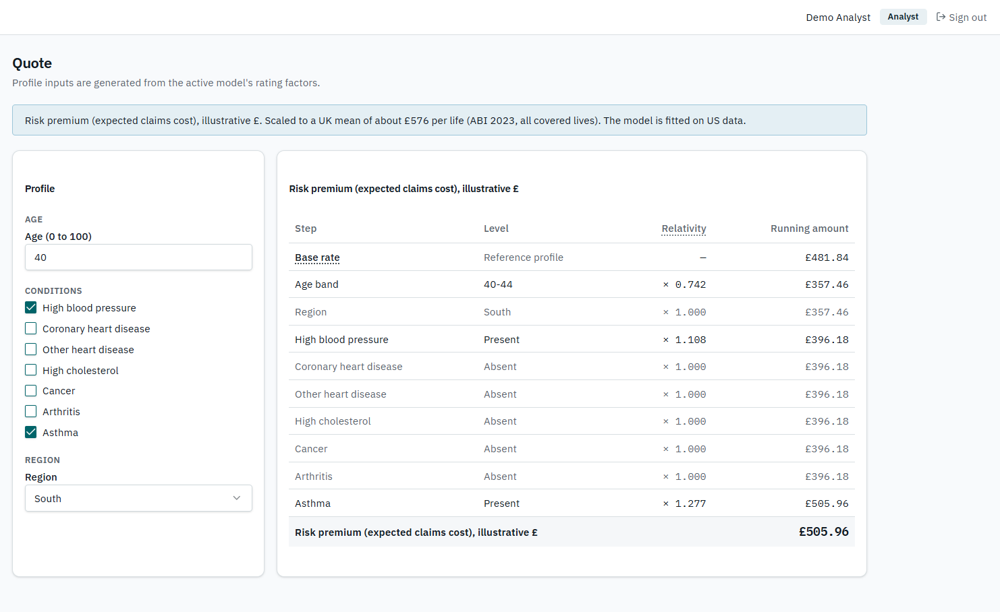 |
| Home. Each underlined term opens a plain-English explanation. | Quote. The premium builds up from the base rate, one factor at a time. |
| 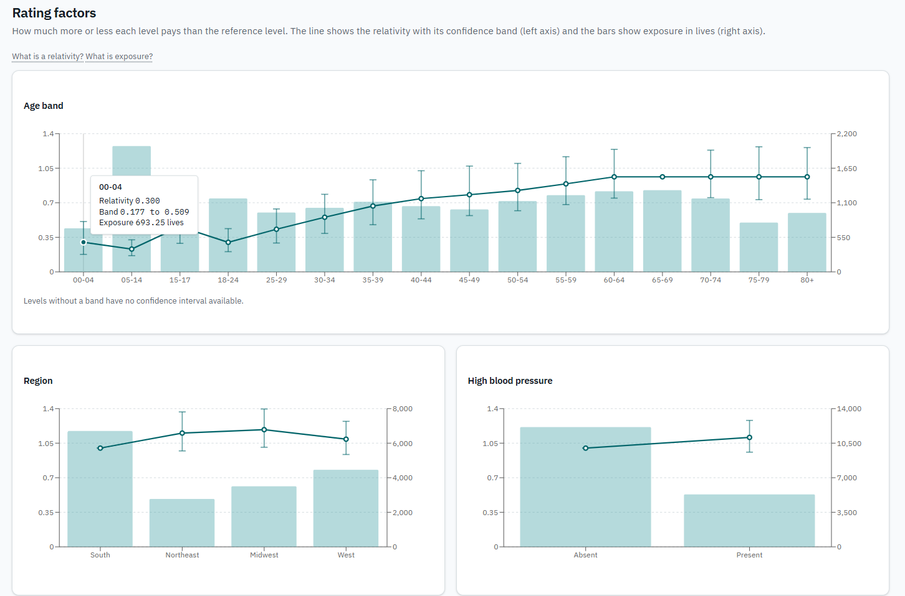 | 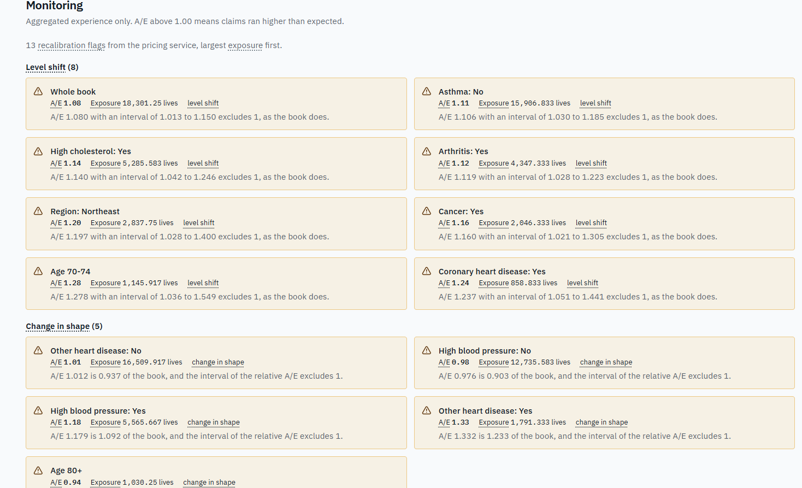 |
| Rating factors, with confidence bands and exposure. | Monitoring. Flags are grouped into level shift and change in shape. |
| 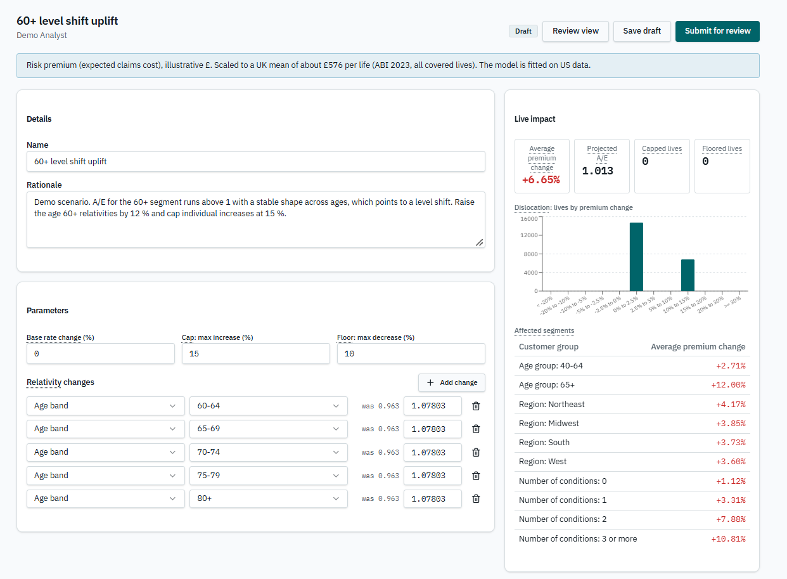 | 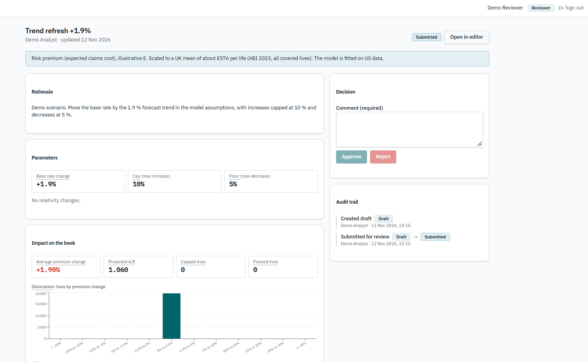 |
| Scenario editor. The impact on the book updates as you change the inputs. | A submitted scenario, read-only, with its audit trail. |

## Observability

The backend sends traces, metrics and logs to Grafana Cloud over OpenTelemetry. Every response carries an `X-Trace-Id` header and every
log line carries the same ID. No customer data, names or tokens go into any signal, and a test checks this.

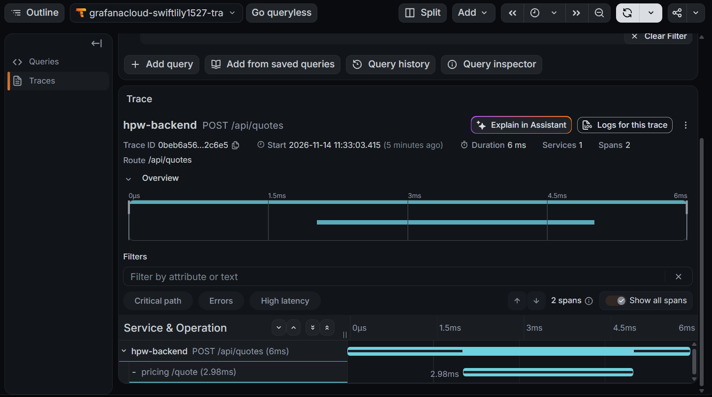

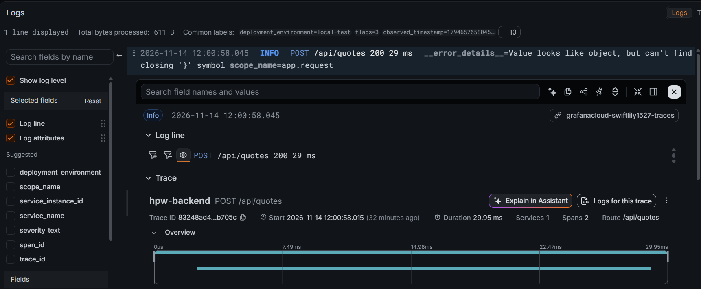

One alert rule fires when calls to the pricing service fail, because users then cannot get quotes. It is stored in
[deploy/grafana/alert-pricing-errors.yaml](deploy/grafana/alert-pricing-errors.yaml). I fired it once on purpose by stopping the pricing
container on the VM for about five minutes.

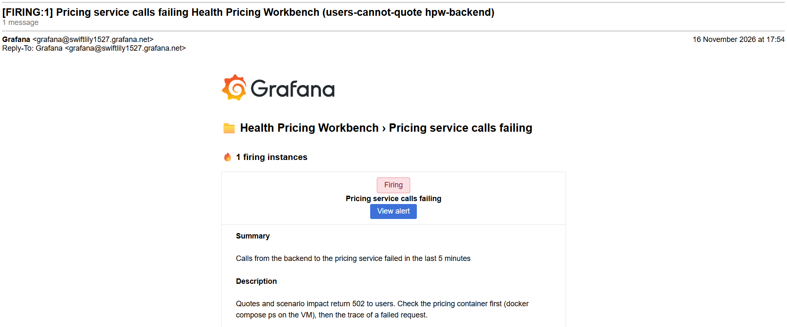

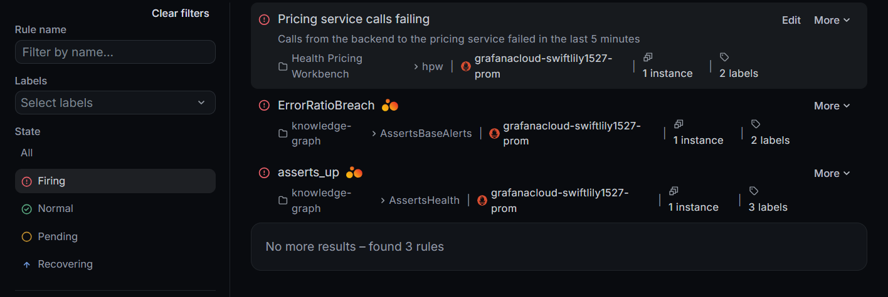

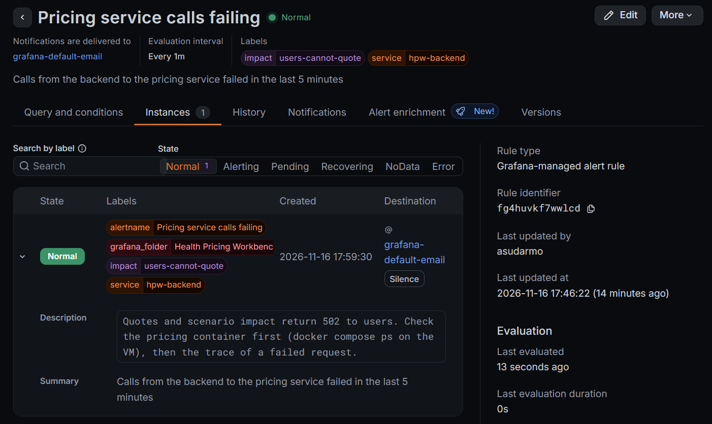

## Run locally

```
docker compose up --build
```

Then open http://localhost:8080 and run `docker compose exec backend python -m app.seed` to load the demo
scenarios. Only the web container is published. The stack pulls the pricing service image v1.1. To run offline
against the recorded mock instead, add `-f docker-compose.mock.yml` to each command.

## Demo data

- `python -m app.seed` adds the four demo scenarios (one per status) if they are missing.
- `python -m app.seed --top-up` adds one Submitted copy only if no scenario is Submitted. It never changes or
  deletes anything. A nightly cron job on the VM runs it so a reviewer always has something to review.
- `python -m app.seed --reset` deletes all scenarios and reloads the four seeds. Run it by hand.

## Run the tests

One command from the repo root runs the backend tests (unit and integration, SQLite and the pricing mock), the
frontend tests and the API contract check. It exits non-zero if any step fails.

```
python scripts/test.py
```

It needs Python 3.12 with the backend virtual environment (`backend/.venv`) and Node 26.

## Course requirements

How the project meets each criterion of the [AI Dev Tools Zoomcamp rubric](https://github.com/DataTalksClub/ai-dev-tools-zoomcamp/tree/main/project).

| Criterion | Evidence |
|---|---|
| Problem description | The sections above and [`_docs/plan.md`](_docs/plan.md) |
| Product specification | [`_docs/plan.md`](_docs/plan.md) · [GitHub issues](https://github.com/asudarmo/health-pricing-workbench/issues) with acceptance criteria and a self-check comment on each |
| Agent team specification | [`_docs/process.md`](_docs/process.md) (Engineer and QA agents) · "How the agents worked" above |
| Context management | [`AGENTS.md`](AGENTS.md) points to the modular documents in [`_docs/`](_docs/) |
| Application | Frontend, backend and database, one command to run locally ("Run locally" above) |
| Testing | Unit and integration tests, `python scripts/test.py` |
| Containerisation | `docker compose up --build` runs the whole system, database included |
| Deployment | Public URL https://35-254-148-15.sslip.io on a free-tier GCP VM, steps in [`deploy/runbook.md`](deploy/runbook.md) |
| CI/CD | GitHub Actions runs the tests on every pull request and push, and publishes SHA-tagged images on `main`. Rollback is a redeploy of the previous tag, tested once. There is no automatic deploy, so I claim 1 of 3 points |
| Observability | Traces, metrics and logs share a trace ID, no customer data, viewable in Grafana ("Observability" above) |
| Alerting on user impact | One alert rule, fired once on purpose, with the email and Grafana screenshots above |
| On-call agent | Not built (stretch task) |

## Limitations

- **Authentication is demo-only.** There are two fixed logins (Analyst and Reviewer) and no passwords. There is
  no sign-up and no admin role. A production deployment would replace this with company single sign-on (for
  example OIDC with Entra ID or Okta), mapping identity-provider groups to the Analyst and Reviewer roles. That
  needs a login flow and token validation in the backend. The role checks and the audit trail stay as they are.
